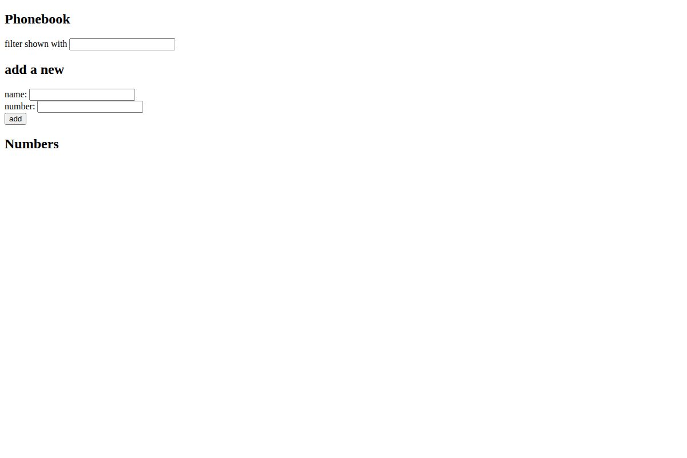
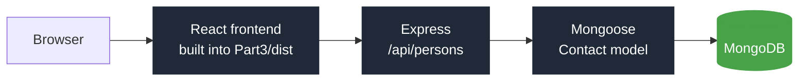
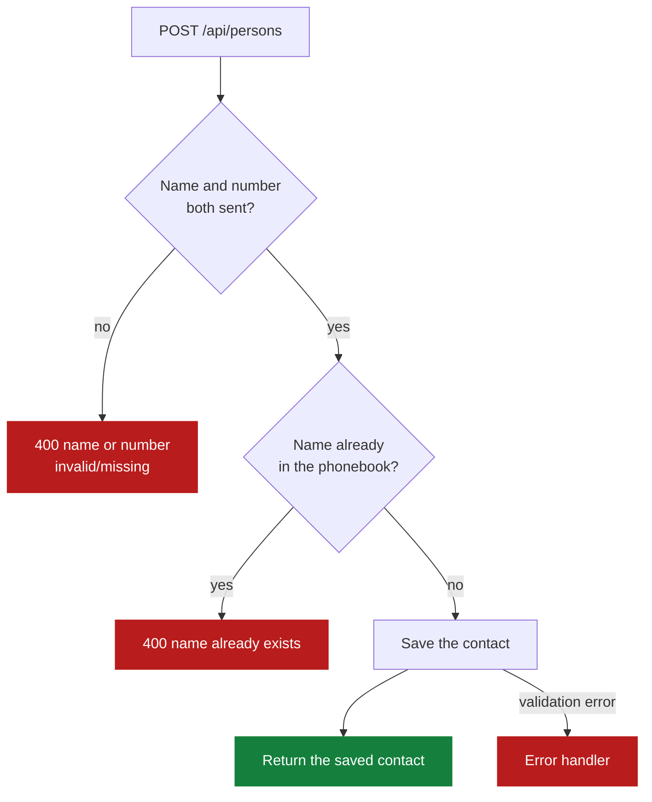
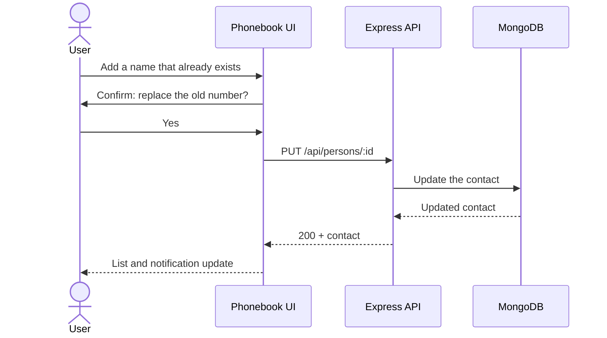

<h1 align="center">Full Stack Open</h1>

<p align="center">My exercise solutions for the University of Helsinki's <a href="https://fullstackopen.com/en/">Full Stack Open</a> course, parts 0 to 4.</p>

<p align="center">
  <a href="https://phonebook-o5nx.onrender.com"></a>
  <a href="https://fullstackopen.com/en/"></a>
</p>
<p align="center">
  
  
  
  
  
</p>

<p align="center"><b>Contributors</b></p>
<div align="center">
<table>
  <tr>
    <td align="center"><a href="https://github.com/comp-Ryan"></a><br/><sub><b>Ryan</b></sub><br/><sub><a href="https://github.com/comp-Ryan">@comp-Ryan</a></sub></td>
  </tr>
</table>
</div>

## What's here

| Folder | Part | What it is |
|---|---|---|
| `Part1/exercises0.1-0.6` | 0 | Notes on how a web app loads (written answers) |
| `Part1/exercises1.1-1.5`, `1.6-1.14` | 1 | React basics: components, state, event handlers |
| `Part2/exercises2.1-2.5` | 2 | Rendering collections |
| `Part2/Phonebook` | 2 | Phonebook frontend: add, filter, update and delete contacts |
| `Part2/exercises2.18-2.20` | 2 | Country search with weather, from the course's REST Countries API and OpenWeatherMap |
| `Part3` | 3 | Phonebook backend: Express + MongoDB REST API that also serves the built frontend; [live on Render](https://phonebook-o5nx.onrender.com) |
| `Part4/BlogList` | 4 | Blog list app: Express + Mongoose backend with `node --test`, and a Vite frontend |
| `practice/` | 1–4 | Code from following along with the course material |

## Phonebook (parts 2–3)

<p align="center"></p>



Routes: `GET /api/persons`, `GET /api/persons/:id`, `POST /api/persons`, `PUT /api/persons/:id`, `DELETE /api/persons/:id`.

### Adding a contact



### Updating a number



## Running a part

Each app folder has its own `package.json`.

```bash
cd Part3            # or Part2/Phonebook, Part4/BlogList/Backend, ...
npm install
npm run dev
```

The backends read `MONGODB_URI` (and `PORT`) from a `.env` file. `npm run build:ui` in `Part3` rebuilds the Phonebook frontend into `Part3/dist`.
